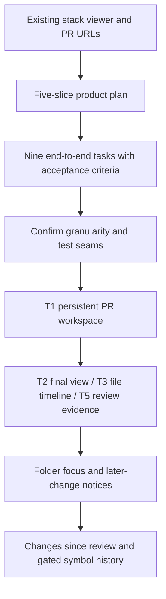

## What

- Used the doc skill to create experiment **1: semantic-stack-review**.
- Wrote plan `../plans/01-2026-10-28-18-20-08-semantic-stack-review.md` and its single
  mutable tracker `../tasks/01-2026-10-28-18-20-08-tasks-semantic-stack-review.md`.
- Kept the user's five slices and decomposed them into nine end-to-end tasks,
  each with blockers and acceptance criteria. All implementation boxes are unchecked.
- No application code changed; no commit requested for this documentation task.

## Key Takeaways

- Reuse existing stack discovery/resolution, parent links, PR/cumulative comparison,
  semantic/text viewer, background preparation, per-revision viewed marks, and
  successful member-switch PR URL updates. These are not new tasks to recreate.
- The current URL parser only restores the PR; new scope, tip, layout, and path
  coordinates belong with the slices that introduce them.
- Core product value: watch a file/folder change across PRs, then expose that an
  earlier review is not review of a later modification or of the final result.
- Stack topology is a tree, not necessarily a chain. Final/file-history views need
  an explicit tip/lane; sibling PRs are not successive versions.
- Git per-PR changed-file metadata gives trustworthy initial history. SemanticDiff
  is the renderer, not a stable file/function identity system.

## Issues

- User approval of the finer task breakdown and proposed testing seam is pending.
- User supplied an earlier report of 100-PR discovery truncation/stale topology.
  This planning pass did not independently verify live GitHub or the 12-member
  example. Keep discovery fixes separate; flag as a live-demo prerequisite only.
- `docs/diff-architecture.md` describes existing cache/process boundaries; preserve
  them. Some generic viewer/default wording can lag current stack-specific UI.
- Function matching remains a gated pilot. Do not promise persistent identities,
  automatic review carryover, or language coverage before fixture evidence.

## Decisions

- **First delivery: T1**, a persistent PR-by-PR workspace with truthful comparison
  context and tested navigation, not a large rewrite of the app.
- T2 (final view), T3 (file timeline), and T5 (review evidence) can follow T1
  independently. Prefer T3 next to reach the user's main file/folder workflow.
- T4 adds folder review; T6 integrates repeated-change notices across views;
  T7 adds bounded changes-since-review; T8/T9 cover gated symbol history.
- No GitHub comment/approval integration, stack authoring, router/store framework,
  discovery overhaul, or mandatory whole-app refactor in this feature plan.
- PR-only links remain backward compatible. URLs identify current workspace
  selection, not historical immutable review snapshots.

## Next

1. Present the plan and task tracker to the user; confirm granularity/blockers and
   existing browser-fixture + local-Git test seams before implementing.
2. Resume with `bash /Users/abhishek/.agents/skills/doc/scripts/resume.sh 1`.
3. Inspect the current tree and `Justfile` again; other sessions have previously
   changed the frontend between messages. Do not rely on old line numbers.
4. T1 starting seams: `web/src/App.tsx`, `web/src/components/DiffViewer.tsx`,
   `web/src/lib/review-location.ts`, `web/src/lib/use-review-navigation.ts`,
   `web/tests/review-navigation.browser.mjs`; backend stack metadata in
   `src/stacks.rs` and session composition in `src/main.rs`.
5. For T3 use existing `Stack::comparison` preparation and `src/warmup.rs` rather
   than inventing another all-files semantic warming pass. Add a typed frontend
   contract at the existing API validation boundary as needed.
6. Validate each implementation with applicable `just check-frontend`,
   `just test-browser`, `just fmt-check`, and `just test`. Browser fixtures must
   include actual changed files and error/race cases, not just empty sessions.
7. Tick the task tracker in place as deliveries pass. Future plan revisions get a
   new numbered plan; do not rewrite this completed planning record.
