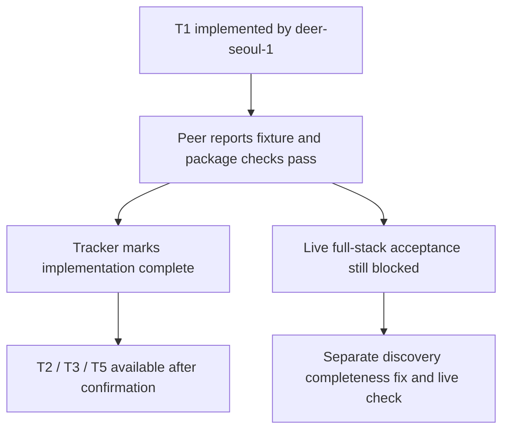

## What

- Recorded `deer-seoul-1`'s T1 completion handoff in the mutable plan-01 task tracker.
- Changed only experiment001 documentation. Application code and experiment002
  remain owned by that peer; no commits made in this handoff.
- T1 is checked for implementation/fixture acceptance, with the live acceptance
  blocker explicitly retained. Other task boxes remain unchecked.

## Key Takeaways

Peer-reported verification (not independently rerun in this documentation update):

- `just check-frontend`: 22 tests pass.
- `just test`: 19 backend tests pass.
- `just test-browser`: built and development StrictMode checks pass.
- `just package`: signed 18.87 MB binary, Rust 1.99.0, no LLVM warning.

Delivered behavior includes the extracted persistent rail, explicit parent/trunk
and actual commit context including focus view, Review from bottom restoring
PR-only/Semantic view, viewed-mark retention, current-PR selection leaving commit
scope, selected-file continuity/fallback, empty-member handling, and commit/PR
stale-response guards. Detailed implementation checkpoint is in experiment002.

## Issues

- The known 100-open-PR discovery cap is deliberately not fixed by T1.
- No live #2480 or complete 12-PR-stack acceptance has been demonstrated. Fixture
  success must not be presented as proof that live topology is complete.
- Cohesive polished, keyboard-first UI design remains a deferred explicit user
  requirement, coordinated in experiment002; current accessibility is preserved.

## Decisions

- Treat T1 implementation dependencies as satisfied while keeping live topology
  validation as a separate acceptance gate. Do not rebuild the workspace.
- Prefer T3 file history next for the user's core workflow; T2 final view and T5
  review evidence can proceed independently after user confirmation.
- Preserve the original plan as an immutable record and update only the task tracker.

## Next

1. Resume experiment001 with `bash /Users/abhishek/.agents/skills/doc/scripts/resume.sh 1`.
2. Read the plan-01 tracker under `docs/experiments/001-semantic-stack-review/tasks/`
   and experiment002's latest checkpoint before touching implementation.
3. Confirm the next task with the user; no automatic authorization to start T2/T3/T5.
4. Reinspect `Justfile`, `git status`, and shared-session ownership. Likely seams for
   T3 remain `src/stacks.rs`, `src/warmup.rs`, the session/API composition, frontend
   API schemas, the stack rail, and existing browser/local-Git fixture tests.
5. Resolve complete discovery separately before claiming the live 12-PR example
   works. Keep later-review notices file-level until symbol matching is validated.
