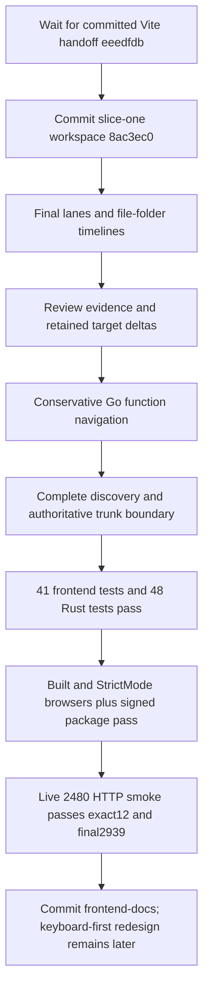

## What

All five functional slices are implemented, including the narrow Go-only pilot.

- T1: persistent sticky stack rail/context, semantic defaults, Review from bottom,
  same-file continuity and stale commit/PR guards. Commit `8ac3ec0`.
- T2: explicit descendant tips and Final stack versus This PR/Through here. The
  original selected PR remains the anchor; branch siblings are not chronology.
  URL coordinates restore scope, tip, diff, layout, path/kind, folder and symbol.
- T3/T4: typed nonblocking PR-local metadata, partial/failed/retry states,
  Git-R-only aliases, union-path tree/filter (200 visible matches), folder-boundary
  focus and next/previous changed file/member navigation. Folder notices use
  linear metadata rollups; no eager rendering of every file.
- T5/T6: canonical-repository/revision/scope/path-specific local evidence, explicit
  outdated and later-edit notices, separate final/file/symbol marks, denied-storage
  memory fallback and explained legacy reset. Limit 512 records/~1 MiB.
- T7: 128 server-memory snapshot identities; reviewed-target-to-current-target
  deltas, explicit basis/topology change text, no browser-selected OIDs, and
  unavailable errors for restart/eviction/missing Git objects. No blob pinning.
- T8/T9: exact same-path qualified Go functions/methods, bounded ranges/previews,
  conservative navigation and explicit symbol evidence. Possible split/merge,
  duplicate, unsupported syntax and moved/renamed/copied cases fall back to files;
  no automatic identity/review carryover or broad cross-language claim.
- Discovery prerequisite: complete GraphQL pagination +60s versioned cache,
  refreshed selected PR/standalone heads and explicit errors. An authoritative
  default-branch boundary prevents staging-release PR #2475 from absorbing all
  feature stacks. Frontend picker mirrors optional `isStackTrunkBase`.

## Key Takeaways

Final integrated checks before frontend commit:

- `just check-frontend`: lint/format/types and **41 tests pass**, including unchanged
  production/profile bundle budgets and lazy grammar checks.
- `just fmt-check`, `just test`: **48 Rust tests pass**, one explicit live test
  ignored by default. Peer separately ran that metadata-only live test successfully.
- `just test-browser`: built and development StrictMode pass, including final lane
  choice/restoration, file/folder skipping, Go ambiguity fallback, evidence updates,
  target-to-target snapshots, missing snapshots in focus view, denied storage,
  keyboard/focus, errors, retries and stale responses. No blanket scenario retries.
- `just package`: Rust 1.99.0, signed **19,066,160-byte** artifact below50 MB;
  no LLVM loader warning and no Vite chunk warning. App chunk~353.56 kB, React~218.84 kB;
  default Vite budget unchanged. Stable semantic-viewer entry retained.
- Actual isolated live HTTP smoke with the packaged executable: pasted #2480
  opens in **3.17s**, **95 changed paths**, selected2480, trunkstaging and EXACT12
  members `[2480,2481,2484,2485,2543,2583,2669,2670,2840,2918,2919,2939]`.
  Metadata poll returned1 ready/11 pending/0 failed without waiting for all.
  Real Go SemanticDiff JSON succeeds with105,894 combined source bytes; retained
  same-target comparison returns an explicit empty since-review delta; actual Go
  pilot returns ready with35 declarations; final2939 comparison returns245 paths.
- Live smoke used a temporary cache clone with shared read-only objects from the
  local Go checkout, fetched through GitHub, and killed its isolated server process
  group/removed its cache afterward. No user repository writes, merges or pushes.
  Script/logs: `/tmp/local-diffe-live-stack-smoke.py`, `/tmp/local-diffe-live-smoke-result.log`.

## Issues

- General cross-language semantic symbol identity is NOT delivered. This is an
  intentionally narrow Go declaration pilot. Mixed edits+additions/removals fail
  closed even when a human could infer safe matching. FNV is a content cue only.
- Historical snapshots are not durable archival copies. Restart/eviction/missing
  Git objects makes old comparisons unavailable while local review evidence stays.
- Browser screenshots use a deliberately blank fixture renderer; they validate
  workspace layout, not real code appearance. Actual SemanticDiff was independently
  verified through live HTTP; no claim of a live browser walk through all12 PRs.
- A polished keyboard-first interaction/visual redesign remains deferred exactly
  as requested. Existing shortcuts and native control accessibility are preserved.
- Generic untracked docs scaffolding outside experiments001/002 is unrelated and
  should not be staged or deleted as part of the feature commit.

## Decisions

- Backend-owned commits: `1a6fd48` history/snapshots/Go support, `100e8f8` split/merge
  fail-closed policy, `95d6c7b` complete discovery/cache, `2e82b7d` default-trunk boundary.
- Keep feature UI within existing API/renderer/navigation boundaries; no new global
  store/router, no new Rust dependencies or toolchain/global-DYLD changes.
- Close the earlier live topology blocker using explicit metadata + actual packaged
  HTTP evidence, while keeping browser fixture validation clearly distinguished.
- Review marks are local evidence, never GitHub approval or proof of final correctness.

## Next

1. Commit owned frontend/README/architecture/experiment001 changes after diff checks.
2. Repackage after the commit so the Git-derived binary version names that commit.
3. Start with `just run`; paste #2480 or use `?pr=<GitHub URL>`, select Final stack
   or Files across stack, and inspect the lane/folder controls.
4. Plan the dedicated polished keyboard-first UI only when the user requests it.
5. For continuation, inspect `web/src/lib/{stack-history,review-evidence,stack-review}.ts`,
   the stack-history/symbol components and `src/{stack_history,review,symbols,github_topology}.rs`.
   Maintain the original snapshot/identity/safety invariants before expanding languages.

