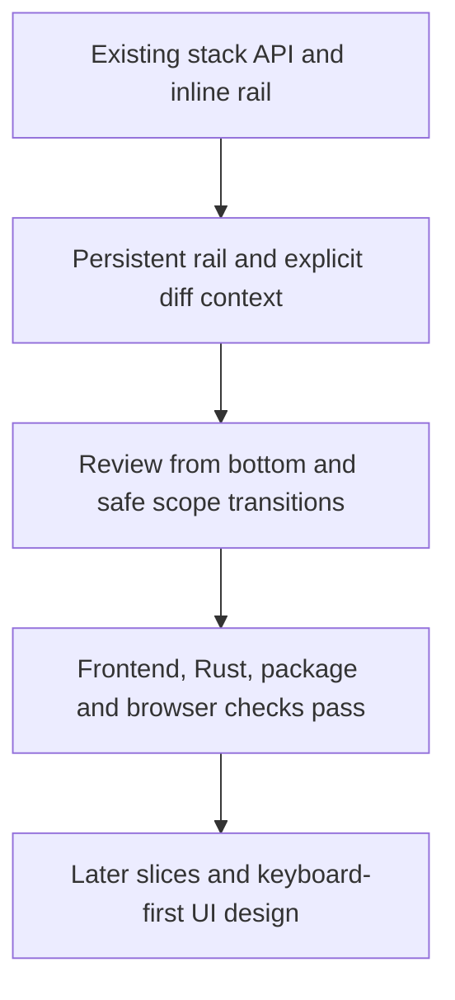

## What

- Extracted `web/src/components/StackRail.tsx`; preserved PR controls/keyboard
  shortcuts, added Review from bottom, focus-visible styling, local scrolling
  to reveal the active PR without stealing focus.
- Added `web/src/lib/stack-review.ts` and context above the diff in
  `web/src/App.tsx`. Full PR comparisons name parent/trunk; commit scopes name
  the actual displayed commit and snapshot range. Context/rail survive focus view.
- Clicking the current PR restores its full comparison from a commit scope.
  Review from bottom uses PR-only/Semantic mode without erasing viewed marks.
  Existing file preservation/fallback and per-PR viewed marks are browser-tested.
- Stack navigation invalidates pending old commit responses; commit selection
  cannot race an in-flight stack switch. No new router or state framework.
- Expanded `web/tests/review-navigation.browser.mjs` with three-member fixtures,
  changed/shared files, a metadata-only member, commit scopes, failures and races.
  Added four context unit tests in `web/tests/stack-review.test.ts`.
- README documents the workspace. No backend/discovery changes or commits.

## Key Takeaways

- `just check-frontend`: lint, formatting, types and all 22 frontend tests pass.
- `just test`: all 19 Rust tests pass.
- `just package`: Rust 1.99.0 build, ad-hoc signing and 50 MB limit pass;
  packaged binary is 18,867,888 bytes; no LLVM loader warning.
- `just test-browser`: built app and development StrictMode pass, twice after
  adding explicit fixture-renderer waits.
- UI screenshots: `/tmp/local-diffe-stack-slice1-built.png` and
  `/tmp/local-diffe-stack-slice1-development.png`. The fixture viewer is blank
  by design; screenshots validate surrounding workspace, not real diff rendering.

## Issues

- Actual PR #2480 can still be missing its stack: discovery lists only 100 of
  182 open PRs and omits immediate child #2481. Incomplete/stale `open.json`
  has no TTL. This is explicitly NOT fixed or live-validated in this UI slice.
- Rustwright initially raised `frame ownership changed during locator resolution`
  when clicking after a status update but before an old iframe detached. Browser
  helpers now wait for the displayed fixture renderer; no blanket test retries.
- Existing Vite chunk-size warnings remain.
- Peer wolf-quito-0 owns experiment001 roadmap/tracker docs; do not overwrite
  their work. Other untracked docs scaffolding is not part of application changes.

## Decisions

- Reuse existing root-session ownership, scopes, cache and shortcuts.
- Do not style earlier stack members as reviewed merely because they precede
  the selected PR; neutral dots avoid implying review evidence.
- Polished, keyboard-first UI is an explicit user requirement deferred to a
  dedicated design/implementation pass. Preserve focus/accessibility now rather
  than add a new keyboard model or shortcuts.
- No final-stack-tip mode, cross-PR file timeline, new progress model, generated
  summaries or function matching in this slice.

## Next

- Restart using `just run` to use the rebuilt packaged frontend.
- Address the separate discovery completeness/cache limitation before claiming
  live #2480 acceptance. Current browser coverage uses complete local fixtures.
- Continue experiment001's later semantic-review slices only with user approval.
- Plan the dedicated polished keyboard-first UI: hierarchy, commands,
  discoverability, predictable focus and pointer parity.

